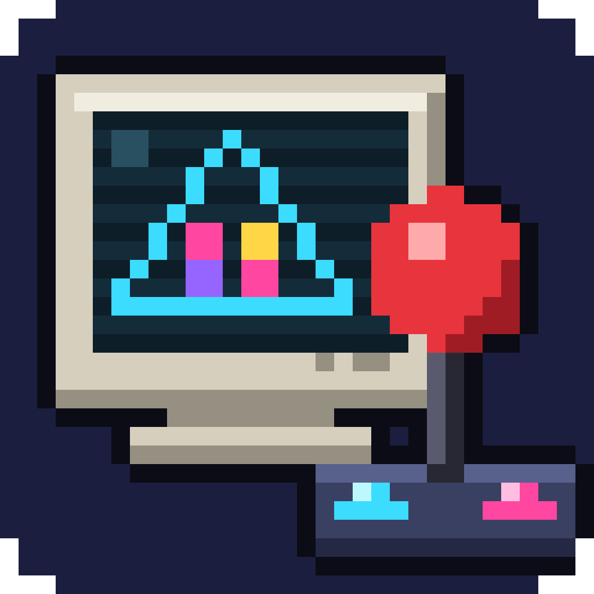

  

<h1 align="center">typex2-recomp</h1>

  Taito Type X and Type X2 arcade games, recompiled to run natively on Android and macOS.

  
  
  

Taito's Type X boards are Windows PCs inside arcade cabinets, so their games
are Windows programs. typex2-recomp is **not an emulator**: it translates each
game's code ahead of time into native code for your device, and supplies
what the game expects from Windows, Direct3D, its sound and the cabinet's
controls. The result runs at full speed on a budget Android tablet.

**Bring your own games.** Nothing from the games is in this project or its
releases: you point the launcher at your own copy, and the recompiling
happens on your computer.

## Games

| Game | Android | macOS | |
|---|---|---|---|
| The King of Fighters XII | ✅ | ✅ | [page](docs/Game-KOF-XII.md) |
| The King of Fighters XIII | ✅ | ✅ | [page](docs/Game-KOF-XIII.md) |
| The King of Fighters XIII Climax | ✅ | ✅ | [page](docs/Game-KOF-XIII-Climax.md) |
| Super Street Fighter IV Arcade Edition | ✅ | ✅ | [page](docs/Game-SSF4-AE.md) |
| BlazBlue: Continuum Shift | ✅ | ✅ | [page](docs/Game-BlazBlue-CS.md) |
| BlazBlue: Calamity Trigger | ✅ | ✅ | [page](docs/Game-BlazBlue-CT.md) |
| The King of Fighters '98 Ultimate Match | ✅ | ✅ | [page](docs/Game-KOF-98-UM.md) |
| The King of Fighters Maximum Impact Regulation A | attract mode tested | ✅ | [page](docs/Game-KOF-MI-Regulation-A.md) |

✅ playable start to finish. Android is tested on a Samsung Galaxy Tab A11
(Helio G99, Mali-G57), where these games run at 60 fps. The status of every
Type X / X2 game, including the ones not supported yet:
[Game status](docs/Game-Status.md).

## Platforms

- **Android:** in RetroArch (one core with all your games) or as a standalone
  app that ES-DE can launch. Rendered with Vulkan (OpenGL ES as a fallback),
  with on-screen touch controls when no pad is connected.
- **macOS** on Apple Silicon: games play right in the launcher, rendered with
  Metal.
- **Linux and Windows:** the launcher runs there and builds the Android
  exports. Playing games on them is in progress.

## Getting started

1. **Download the launcher** from the
   [releases page](https://github.com/PabloVSouza/typex2-recomp/releases):
   `.dmg` (macOS), `.AppImage` / `.deb` (Linux, glibc 2.39+, as on Ubuntu
   24.04), `.msi` / setup `.exe` (Windows). The apps aren't signed yet:
   on macOS allow it once in System Settings → Privacy & Security ("Open
   Anyway"); on Windows choose SmartScreen's "More info" → "Run anyway".
2. **Add your games:** each game's folder, the one with its `game.exe`. The
   launcher recognises the game from it.
3. **Play or export:**
   - On a Mac, press Play: the launcher recompiles the game the first time
     (a few minutes), then starts it.
   - For Android, export the **RetroArch core** or the **Android app** with
     the games you choose, then install it on the device:
     [Android and RetroArch](docs/Android-and-RetroArch.md).

The launcher downloads the build tools it needs (clang, CMake, Ninja, the
Android NDK) into its own folder: [Launcher](docs/Launcher.md).

## Controls

Gamepads and arcade sticks work out of the box, with a layout per game that
matches its arcade panel (four buttons for KOF and BlazBlue, six for Street
Fighter). Hold Select / Back for the game's test menu. Custom layouts and
keyboard keys: [Controls](docs/Controls.md).

## Documentation

Everything is in [`docs/`](docs/Home.md), also published as the
[wiki](https://github.com/PabloVSouza/typex2-recomp/wiki):

- [Android and RetroArch](docs/Android-and-RetroArch.md): installing the core
  and the app, ES-DE, settings.
- [Controls](docs/Controls.md) · [Launcher](docs/Launcher.md) ·
  [Game status](docs/Game-Status.md) · a page per game.
- For developers: [Building from source](docs/Building.md),
  [Architecture](docs/Architecture.md),
  [Porting a game](docs/Porting-a-Game.md), [Debugging](docs/Debugging.md),
  [Hardware](docs/Hardware.md), and the [progress log](docs/Progress-Log.md).

What changed in each release: [CHANGELOG.md](CHANGELOG.md).

## Community and help

- **Discord:** [discord.gg/bEQYMsEe9A](https://discord.gg/bEQYMsEe9A): help in
  #support, bug reports, performance results and stick layouts.
- **Bugs and ideas:**
  [GitHub issues](https://github.com/PabloVSouza/typex2-recomp/issues).
  Please include your device, how you run it (RetroArch, the app, the
  launcher), the game, and the log.
- **Contributing:** start with [Building from source](docs/Building.md) and
  [`CLAUDE.md`](CLAUDE.md), the project's working rules.

## Legal

typex2-recomp is an independent fan project. It is not affiliated with or
endorsed by Taito, SNK, Capcom or Arc System Works, and contains no game code
or assets. Game names and trademarks belong to their owners. Please own the
games you play.
