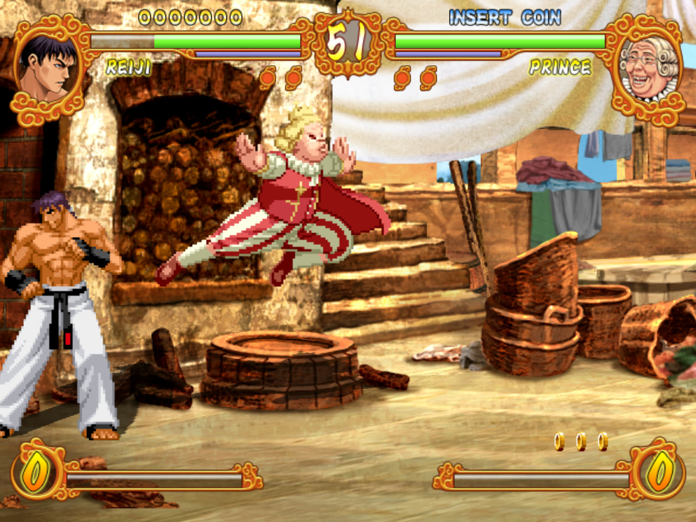

# Gouketsuji Ichizoku Matsuri Senzo Kuyou

| | |
|---|---|
| Board | Type X2, NESiCAxLive (Atlus / Noise Factory; this build: version 1.0.1, 2011/12/1) |
| `games/` id | `goketsuji` |
| Status | **Playable** on macOS: attract mode with its opening movie, coin / start, character select, fights with sound, and the test menu. The Android app runs a scripted fight at 60 fps on the test tablet; the RetroArch core runs it below 60 (see Known issues). Not played by hand yet. |
| Executable | `Game.exe` (the runtime and the launcher find it whatever its case). |

## Controls

The game's own BUTTON SETTINGS put weak / strong punch on cabinet buttons 1
and 2 and weak / strong kick on 4 and 5, the same buttons as KOF's A C over
B D, so pads get the KOF layout with the buttons called LP HP / LK HK. Each
player is a separate I/O node; the test switch (F2, or hold Select) opens the
test menu, which is in Japanese. Layouts: [Controls](Controls.md).

## What it needed

- **iDmacDrv32.dll.** NESiCAxLive cabinets read their controls through
  Taito's "FAST I/O" board, opened by ordinal from `iDmacDrv32.dll` and
  polled as registers: node status words at 0x4000 / 0x4004 (both nodes must
  read as linked, or the game stops at FAST IO INITIALIZE ERROR), one input
  word per player at 0x4120 / 0x41a0, coin counters at 0x4140 / 0x41c0.
  `hle/idmac.c` serves them from the same input state as the JVS board
  (`jvs_get_switches`). `GetProcAddress` now resolves ordinals.
- **setjmp / longjmp.** The game's task system ends a task with
  `longjmp` back to its scheduler. The recompiler recognises MSVC's
  `_setjmp3` and pairs every call to it with a host `setjmp` in the same
  frame; when the guest `longjmp` jumps back to that call's return address,
  the dispatcher `longjmp`s the host there (`X2_SETJMP`, `dispatch.c`). KOF
  XII, XIII, XIII Climax and SSF4 also call `_setjmp3` (their image decoders),
  harmlessly.
- **ID3DXSprite and ID3DXFont.** Everything is drawn with `ID3DXSprite`
  (`hle/d3dx_sprite.c`: screen-space quads queued by `Draw`, drawn at `End`
  through the device's own methods), and the test menu with `ID3DXFont`
  (`hle/d3dx_font.c`: glyphs from the host font backend in an atlas texture,
  drawn as sprites).
- **The opening movie.** A sample grabber asking for RGB24 at the movie's
  size (it was fixed to KOF XII's YV12 at 1280×720: the game copied 720 rows
  into a 480-row texture), an `IVideoWindow`, and
  `IMediaEvent::WaitForCompletion` reporting completion only at the end (it
  said "complete" at once, so the movie stopped after one frame).
- **NESiCAxLive client.** The game looks for the client through a named pipe,
  shared memory and `HKLM\SOFTWARE\TAITO\NESiCAxLive`; with none of them it
  plays with its defaults. File mappings and the wide registry calls are
  implemented for it.
- **Settings.** `Debug.ini` is read (and written by the test menu) with
  `GetPrivateProfileIntW` / `WritePrivateProfileStringW`.
- **Case.** The game asks for `data\effect\...` in its `Data/Effect` folder:
  on case-sensitive storage (Android, Linux) paths are matched without case.

## Known issues

- Not played by hand yet.
- **RetroArch: about 46 fps in fights** on the test tablet (the Android app holds
  60). The GPU is the limit: a fight frame takes 15 ms of GPU time in the app and
  19 ms in RetroArch, whose own drawing shares the GPU. The game switches render
  targets about 146 times a frame (it builds each group of sprites in a
  2048x1024 target, then copies it to the backbuffer), and on a tile GPU each
  switch ends a render pass. The game's own frame limiter is not the cause:
  turning it off changed nothing. Play it in the Android app meanwhile.
