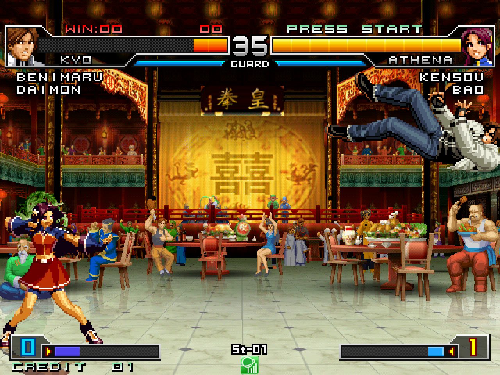

# The King of Fighters 2002 Unlimited Match

| | |
|---|---|
| Board | Type X2, NESiCAxLive (SNK Playmore, 2011; this build: version 1.20, 2011/11/24) |
| `games/` id | `kof2002um` |
| Status | **Playable** on macOS: attract mode with sound, coin / start, How to Play, team and order select, fights, the test menu. The Android app runs a scripted fight at 60 fps (about 1.3 ms of game work a frame on the test tablet). Not played by hand yet. |
| Executable | `game.exe` (TeknoParrot-format dumps work: the extra DLLs in the folder are ignored) |

## Controls

A B C D are on cabinet SHOT1-4 in a row (the INPUT TEST shows A-F on SHOT1-6),
not on SHOT1 SHOT4 SHOT2 SHOT5 like KOF XII: pads get the KOF layout with that
mapping, and `X2_PAD`'s letters a-d follow it. The test menu opens with the
test switch (F2, or hold Select). [Controls](Controls.md).

## What it needed

- **The NESiCAxLive client.** The game won't start without it: it connects to
  the pipe `\\.\pipe\nesys_games` and runs a boot sequence of requests (server
  authentication, version, network settings, income mode, global IP), each
  waiting for its reply. `hle/nesys.c` is that client: it answers each request
  with the reply type the game turns into the event it waits for (read from the
  game's parser at `0x7b9e30` and its boot states), with empty payloads (an
  offline cabinet), and reports no NESiCA card (`card_id` empty), which keeps the
  game away from its MSXML 4 requests. Reads on the pipe stay pending until a
  reply exists, as the game's overlapped reader expects.
- **The NESiCA card reader**, a second JVS device on COM2: general-purpose
  inputs (`0x26`, no card), card read (`0x61`), and `0x62`.
- **iDmacDrv32.dll is cdecl.** The callers pop the arguments; the HLE popped
  them too, which shifted the stack (Gouketsuji survived it by luck).
- **Waits on handles that are no object fail at once** (`WAIT_FAILED`), as on
  Windows: the game tears down its client link, never opened, by waiting on its
  mutex.
- **A blank glyph is 0 bytes, not an error.** The game sizes its text buffers
  with `GetGlyphOutlineA`; `GDI_ERROR` for a space became a 4 GB allocation and
  `std::bad_alloc`. `RaiseException` now names a thrown C++ type and the guest's
  call chain before stopping.
- **Windows bits:** `CreateFontIndirectA`, `GetTextMetricsA`,
  `GetGlyphOutlineA`, `D3DXCreateFontA`, the `d3dx9d_42.dll` debug D3DX,
  OLE Automation strings and variants (`SysAllocString`, `VariantClear`, ...),
  named-pipe calls, `lstrlenW`, `IsDBCSLeadByte`.
- **Shift-JIS.** The boot screen's status lines are Shift-JIS strings, split
  with `IsDBCSLeadByte` and drawn character by character with
  `GetGlyphOutlineA`. The game sees code page 932, as on the cabinet's
  Japanese Windows (`cp932.c`).

## Known issues

- Not played by hand yet; RetroArch not tried yet.
- The boot screen reports that NESiCA's exclusive control couldn't be
  processed (NESiCAの排他制御が処理できませんでした), then starts normally.
  That step reads the card id from the NESiCAxLive client, which reports no
  card: with one, the game would go on to XML requests through MSXML 4, which
  the runtime doesn't have.
- Rankings and other NESiCAxLive network features are offline.
