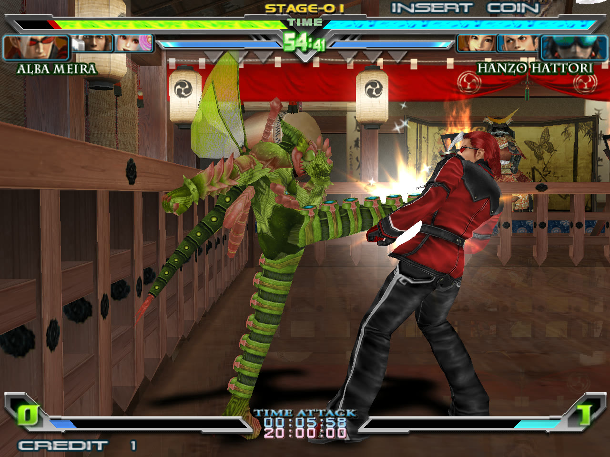

# The King of Fighters: Maximum Impact Regulation A

| | |
|---|---|
| Board | Type X2 (2007, SNK Playmore) |
| `games/` id | `kofmira` |
| Status | **Playable** on macOS: opening movie, attract demo, test menu, character select and fights. Android: attract mode at 60 fps (RetroArch and the app); in RetroArch, fights (scripted: three characters, colours and order) at 60 fps. |
| Executable | `game.exe` (PE32, 28 MB image; RenderWare engine; data in `data/`, `diskimg/`) |

## Controls

Same panel and default layout as [KOF XII](Game-KOF-XII.md). The game's INPUT
TEST confirms A B C D on cabinet SHOT1, SHOT4, SHOT2 and SHOT5.

## What it needed

- **Frame pacing.** The main loop (0x40a8b0) spins on `timeGetTime` and runs
  a frame each time elapsed ms × 60 passes 1000. Against the display's clock
  that ran two frames back to back now and then: on Android a third of the
  frames on the select screens and the pre-fight scene came late (12-17 of
  120 after the fix). A byte patch in `lift.cpp` makes it run one
  frame per pass.

- **C runtime as a DLL.** It links `MSVCR80.dll` instead of carrying the CRT
  in the executable. `hle/msvcrt.c` implements its 93 imports. Two of them
  (`_acmdln`, `_adjust_fdiv`) are variables, which the loader now binds as
  data imports.
- **Direct3D 8.** The game renders with D3D8. `hle/d3d9.c` has a D3D8 layer
  over the D3D9 implementation:
  - IDirect3D8 / IDirect3DDevice8 and the D3D8 texture and surface vtables;
  - vertex shaders from D3D8 declaration tokens (input registers bound by
    inserted `dcl` instructions);
  - sampler states set through texture stage states;
  - `SetIndices` with a base vertex, `CopyRects`;
  - token-based state blocks.
- **DirectDraw overlay movies.** The opening movie plays in a YUY2 overlay
  surface: `hle/ddraw.c` provides the surfaces and flipping. The overlay is
  drawn over the frame at `Present` and disappears when the game releases it.
- **Recompiler:**
  - code in a second section (`PSFD00`, the movie middleware) is now
    discovered;
  - MMX / SSE2 saturating, averaging, multiply-add, pack and word-shuffle
    instructions, used by the movie decoder;
  - 16-bit `pushf` / `popf` (a CPUID probe).
- **Files:** `mmio*` WAV reading, and drive-relative paths (`C:data\x.bmp`,
  RenderWare's file system).
- **Memory:** surfaces are freed when released. The game creates an image
  surface every frame.

## Known issues

- Android: the opening movie and attract mode run at 60 fps on the test tablet (RetroArch and the app, Vulkan and GL). Scripted fights in RetroArch (`X2_INPUT`: coin, start, three characters with their colours, the order with A B C) run at 59.5-60.5 fps with 13-17 late frames per 120; the game thread's frames reach 15-23 ms, close to the budget. The fight start loads in one frame of about 1 s, and each next team member in 0.3-0.5 s: mostly the game's own loading. Not played by hand yet.
- Some test-menu sound effects are missing from the dump (`mmioOpen` fails,
  harmlessly).
- In the C runtime, `longjmp` and C++ / SEH exception dispatch are not
  supported; they stop with a named error.
