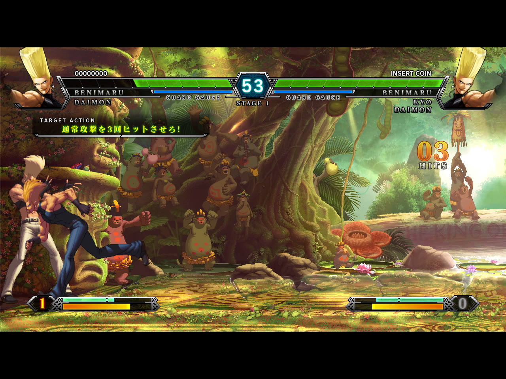

# The King of Fighters XIII Climax

| | |
|---|---|
| Board | Type X2 (2012, SNK Playmore) |
| `games/` id | `kof13cl` |
| Status | **Playable** on macOS, the Android app and RetroArch on Android |
| Executable | `game.exe` (data in `media.kof`, keys in `TypeXmulti/`) |

## Controls

Same panel as [KOF XII](Game-KOF-XII.md).

## What it needed

- **Flags across calls.** The MSVC CRT's x87 maths helpers, such as `sin`,
  return results in EFLAGS that the caller tests. The recompiler keeps flags
  in C locals, so `sin()` returned garbage. That broke the burn texture and
  made stage elements flash. `Lifter::analyze_flag_exports` now carries flags
  out of those helpers.
- **16:9 inside 4:3.** Climax composes a 1280×720 scene into a 640×480
  backbuffer. The backbuffer renders at 2× (`X2_BB_SCALE`) and both front
  ends crop the 16:9 band, so the screen gets a true 1280×720 picture.
- **Natives.** zlib `inflate_fast`, plus an unoptimised byte-fill loop that
  dominated loading on Android.
- **Link-time optimisation.** The game was built unoptimised: its hot paths
  call one-line getters, and each call was a spill and reload of every
  register. ThinLTO inlines them across the generated files. On the Galaxy
  Tab A11, heavy stages went from 16.5-18 ms a frame (about 50 fps) to
  11-13 ms, so every stage tested holds 60.
- **Archive tool.** `tools/kofarc` lists and extracts `media.kof`, decrypting
  TXAC entries with the key in `TypeXmulti/txac`.

## Known issues

None open.
