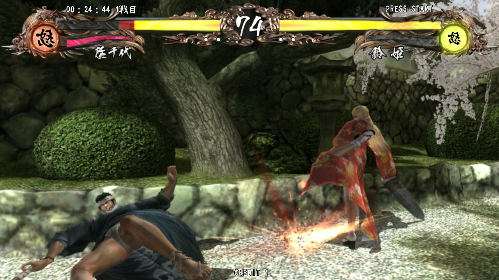

# Samurai Shodown: Edge of Destiny

Samurai Shodown: Edge of Destiny (サムライスピリッツ閃, *Samurai Spirits
Sen*), SNK Playmore, 2008, Taito Type X2. `games/sse`.

**Status: fights run** (macOS and Android, scripted input). Attract mode with
its movies, coin and start, character select, the story screens and fights
all run, with the stages, the toon-shaded fighters and their shadows
rendered: at 60 fps in the game's HD mode (1280×720) on macOS, and at 60 fps
in its SD mode (640×480) on the Android test tablet, in the app and in
RetroArch. In the launcher and the Android app. A scripted arcade run (EASY,
one round) on macOS won two fights, lost the third, continued, picked the
character again and fought on; the later stages, the boss and the endings
are not reached by a script and wait for a real playthrough.

## Controls

The cabinet has four buttons, A B C R (SHOT1-4): the same panel as
BlazBlue's, and the same pad layouts with R in place of D
([Controls](Controls.md)).

## Files

The game folder needs `game.exe`: the runtime recompiles it, not
`launcher.exe`. The meshes and textures are in `Bin/` (`.K2MP` archives), the
compiled effects in `Shader/`, the movies in `Bin/MOVIE` (WMV; `J_SD` holds
the SD versions).

## What it needed

- **HD mode.** At start-up the game looks at the first function in the I/O
  board's feature list: an odd code, as switch inputs (0x01) are, selects
  HD, 1280×720 with the HD movies; otherwise it runs in SD, 640×480 (4:3).
  The emulated board lists switch inputs first, so the game runs in HD;
  for SD it lists the coin inputs first: the default on Android, where an
  HD fight frame needs about 16.5 ms of GPU time on the test tablet (the 3D
  scene at 1152×648) and the display showed 35-40 fps; SD needs about
  11 ms. `X2_HD=1` / `X2_HD=0` in `x2.env` choose. The display modes
  offered include 1280×720.
- **The I/O board start-up.** Common copies of `game.exe` have the call that
  sets up the board's polling (0x40117a in `main`) and the wait for its first
  reply replaced with NOPs, so `main` read the switches before any poll and
  the game always ran in SD. The recompiler puts the original instructions
  back when it recognises those bytes (`kPatches` in `lift.cpp`).
- **`.X` meshes.** The stages are `.X` meshes: `D3DXLoadMeshFromXInMemory`
  reads binary `.X` files (templates, normals, texture coordinates, vertex
  colours, materials, `DeclData`) into an `ID3DXMesh` whose `DrawSubset` the
  game calls (`hle/d3dx_mesh.c`).
- **Effect state.** `ID3DXEffect::Begin` without `D3DXFX_DONOTSAVESTATE`
  saves the device states the passes change, and `End` restores them, as
  D3DX does.
- **D3D9 shader maths.** The fighters' shader adds a point light whose
  1/range is infinite when there is none; the hardware's `cmp` picks the
  other side without arithmetic, but the translation blended both sides, and
  inf × 0 made the fighters black. `cmp` / `cnd` now select (`mix` with a
  boolean vector), and `pow(0, 0)` is 1 as on D3D9 hardware.
- **Shadow maps.** The fighters' shadows sample a depth texture, which on the
  Type X2's NVIDIA GPU returns a filtered depth comparison. Metal does the
  same (`sample_compare` in a shader variant per sampler bound to a depth
  texture), Vulkan and OpenGL (`sampler2DShadow`). The game sets the sampler's
  border to the bits of 1.0f, depth 1 outside the map (lit): compare
  samplers take the border's red channel as the depth. The stages also
  read a colour copy of the map, depth in red, with the same border: as a
  colour that is red 0.5, but that shadows the background wherever it lies
  past half the light's range (a dark shape moving with the fighters), so
  every renderer returns white, as the game means. Transparent black had left
  the floor dark everywhere outside the map, a lit square that followed the
  fighters. Other border colours are exact on Vulkan where the driver has
  `VK_EXT_custom_border_color`.
- **Frame limiter.** Before each `Present` the game sleeps until 1/60 s has
  passed since the last one returned. The runtime paces `Present` itself;
  in RetroArch, where `Present` returns when the frontend's frame starts,
  every core frame waited the whole 1/60 s for the game. The recompiler sets
  the limiter's rate to 0, which the game takes as no limit.
- **Direct3D enumeration.** The game's DXUT-style enumeration drops a device
  whose caps have `D3DPMISCCAPS_NULLREFERENCE`; the caps no longer set it,
  and only the HAL device exists.
- **DirectInput.** `joyGetNumDevs` returns 16 (the joysticks the driver
  supports), as Windows does; 0 failed the game's DirectInput set-up.
- **DirectSound notifications.** The game asks a buffer for
  `IDirectSoundNotify`, releases it, and asks again: the notify interface
  now shares the buffer's reference count, as in DirectSound, instead of
  being freed and handed out again.
- **Swap chains.** `GetSwapChain` / `GetNumberOfSwapChains`: the device's one
  chain.
- Smaller HLE: an empty registry (keys not found), `GetAdaptersInfo`, window
  placement and hot keys, memory DCs, D3DX maths (`D3DXMatrixLookAtRH`,
  `D3DXMatrixPerspectiveFovRH`, `D3DXMatrixAffineTransformation`,
  quaternions, `D3DXVec3Hermite`...), `D3DXFillTexture`, `D3DXFrameFind`,
  `D3DXCreateEffectFromFileA`, the non-Ex texture loaders.

The game opens `Dic32.dll`, a smart-card reader client, only from code that
this `game.exe` does not run.

## Known issues

- **Movies blinked** on Android: single black frames, a few a minute in
  some runs and none in others. They showed the overlays over a black
  picture, as the Vulkan present's clear without its blit would; the
  present now draws the picture in one pass (which also removed a block of
  garbage beside the 4:3 picture on the Mali GPU). Not seen since, but the
  blinking never reproduced on demand.
- **Android in HD** (`X2_HD=1`): a fight frame needs about 16.5 ms of GPU
  time on the test tablet, so fights mostly hold 60 fps and dip during the
  large animations (the round start). `X2_SCENE_SCALE=0.75` renders the 3D
  scene at 75% (HUD at full size): 12.7 ms, 60 fps throughout.
