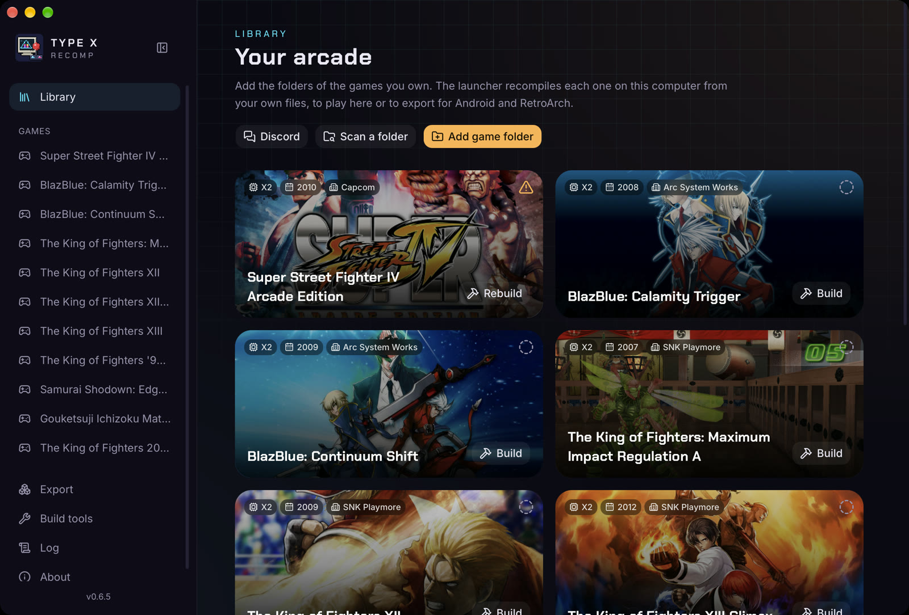

# Launcher



The launcher is a desktop app for macOS, Linux and Windows, and the Type X2
app on Android. On a computer it turns the games you own into native builds,
without a terminal:

- **for this computer**, to play them from the launcher;
- **for other platforms**: the RetroArch core for Android, game packs for
  the Android app, or the RetroArch core for this computer.

On Android it plays them: the library comes from ES-DE's ROMs folder and each
game's code from its pack ([Android and RetroArch](Android-and-RetroArch.md#the-app)).

It is a Tauri app (Rust back end, React front end) in `launcher/`.

## What it does

| Page | |
|---|---|
| Library | Add game folders, or scan a folder that holds several (searched 4 levels deep; hidden folders skipped; each game's first copy counts). A game is recognised from its `game.exe` / `launcher.exe` (PE image size and entry point), so the folder's name does not matter. Games not supported yet are listed too, under their folder's name, as *Not supported yet*. |
| Game | Build or rebuild for this computer, Play / Stop, display options (full screen, vsync, FPS counter, render scale; on Android the touch pad and its buttons: this project's layout, Neo Geo or custom, two rows of four, saved as `X2_TOUCH_BUTTONS`), the controller layout (presets per game, or remapped button by button: Assign, then press the controller button; saved as an `X2_PAD` line. On Android the app passes every controller button and trigger to the page itself, so sticks Android doesn't know, whose L2 / R2 are triggers, can be assigned too), log detail and extra `X2_*` switches. |
| Export | Pick a target and games; the result lands in the launcher's `exports/<target>/` folder. An Android export can go straight to a connected device (USB debugging, or wireless debugging paired with `adb`): **Send to device** puts game packs in the Type X2 app's folder (it installs them when it opens), or copies the core to `RetroArch/downloads/` for RetroArch's *Install or Restore a Core*. |
| Build tools | What building needs, where each tool comes from, downloads and their removal. Android's platform tools (`adb`, for Send to device) download here too, or come from the Android SDK. |
| Log | The game's output and the build tools' output. **Report a problem** copies a report (launcher version, system, each game's build state, the last 200 lines of both logs; home folders shown as `~`) and opens a new GitHub issue to paste it into. |
| About | The launcher's language, updates (below), the installation (version, kit, data folder). |

**Game art.** The library cards and the game page show art for each game: the user's own ES-DE scraped media first (fanart, screenshots, title screens, miximages, then covers, named after the game's folder, in ES-DE's media folder: `~/ES-DE/downloaded_media`, `/storage/emulated/0/ES-DE/downloaded_media` on Android, or the MediaDirectory set in ES-DE), else the image of the game's console port on libretro's thumbnail server (`thumbnails.libretro.com`, RetroArch's; the request names only the game), fetched once into the data folder's `art/`. Without either the card shows a plain background; Refresh reloads the art. Narrow windows (a tablet held upright) show the sidebar as an icon rail; the button by the logo slides it away (full-screen mode, remembered), leaving the logo and that button, which brings it back, and the library takes the width. `art.rs`.

**Controllers.** The launcher can be used with a controller (or the arrow keys): the d-pad or the left stick moves to the nearest control that way, A presses it, B closes a menu or goes back to the library (Android's Back does the same, and only leaves the app from the library). A game card is one stop: A plays the game (its page when it cannot start here), X opens its page. Once a controller button (or an arrow key) is pressed, every control is highlighted the same way, without a focus outline: the focused one stays at full strength and grows slightly, the others in the page or the sidebar fade, until the next touch or click. The focused control is kept in the middle of the page as it scrolls; up or down with no control further that way scrolls the page; A controller puts the launcher in full-screen mode (once per session); the menu then shows over the page for a moment: left from the page's leftmost control or Y opens it and moves into it, and going back to the page (right, B, Y or choosing a page) hides it again. The menu button by the logo, reachable with the d-pad, keeps it open. `useControllerNav.ts`, `spatialNav.ts`. On Android the launcher asks for the display's fastest refresh rate (90 Hz on the test tablet), the games keep 60.

**Updates.** The launcher asks GitHub for the latest release at start and every six hours (About → Updates turns that off; Check now works either way). A newer one shows a banner with its notes (Markdown without HTML or images) and a button to its release page; nothing is downloaded or installed by the launcher. A release-candidate build (its tag baked in as `X2_RELEASE_TAG` by `release.yml`) also learns of newer candidates. `updates.rs`.

## How a game is built

1. **Generate:** `x2recomp` turns the executable into C in the launcher's
   data folder (`work/games/<id>/gen`). This step is redone only when the
   executable or the kit changes. The kit's identity is the recompiler
   binary plus `recomp.h`.
2. **For this computer:** the generated C is compiled with the flags CMake
   uses for generated code, then linked into one library (`game.dylib` /
   `.so`). `x2-player`, the runtime built as an executable, loads it with
   `--game-lib`:
   - The library exports one symbol, `x2_game_tables`: the generated tables
     under new names, as the multi-game builds do.
   - On macOS it is linked as a bundle against `x2-player`, so runtime symbols
     (thread-locals included) bind to the player at link time.
   - KOF '98 UM takes about 7 seconds to compile on an M3 Pro, and its frames
     are pixel-identical to the CMake executable's.
3. **Exports:** the project's own CMake build over the generated code
   (`-DX2_GAMES_DIR`, `-DX2_GAMES`). For Android it uses the NDK toolchain.

## RetroArch on a computer

The core holds no games until you build it: it is not an emulator that reads
any `game.exe`, but the recompiled code of the games chosen at export.

1. In the launcher, add your game folders (only supported games can be
   chosen; the others are listed as *Not supported yet*).
2. Export → **RetroArch core for this computer**, pick the games.
3. Copy `typex2_libretro.dll` (Windows), `.so` (Linux) or `.dylib` (macOS)
   into RetroArch's `cores` folder, and `typex2_libretro.info` into its
   `info` folder.
4. In RetroArch, Load Core → *Taito - Type X2 (Type X2 recomp)*, then Load
   Content → the game's `game.exe` (`launcher.exe` for KOF '98 UM). The core
   recognises the game from it and runs that game's code.

To add a game later, export the core again with it. On computers the core is
untested so far (development and testing happen with the Android core).

## Build tools, kept inside the launcher

The launcher downloads pinned versions into its own `tools/` folder, checks
them against their published checksums, and removes them in one click. Builds
then run with only those tools and the OS's base folders on `PATH`.

| Tool | Version | For | Checksum source |
|---|---|---|---|
| LLVM clang + ld64.lld (macOS arm64) | 23.1.4, trimmed | Playing on this computer | SHA-256, pinned |
| CMake | 4.5.0 | Exports | SHA-256 from the GitHub release |
| Ninja | 1.13.2 | Exports | SHA-256 from the GitHub release |
| Android NDK | r30 | Android exports | SHA-1 from Google's SDK repository manifest |

The downloaded clang has no OS SDK:
- Generated code compiles against clang's own headers plus small stand-ins for
  `math.h` and `string.h` (`runtime/include/sdkless/`).
- The C library's functions are looked up when the player loads the game.

Without downloads, tools already installed are used instead (Xcode Command
Line Tools, CMake, Ninja, an NDK found under the Android SDK).

## What a release contains

The app, `x2recomp`, `x2-player`, the libraries those two link, and the
runtime sources that exports build from. `launcher/scripts/stage-kit.sh`
gathers these into `src-tauri/kit`.

A release contains no game code or data. Everything generated from a game
stays in the launcher's data folder, apart from the exports the user makes.

## Status

- **macOS (Apple Silicon):** verified.
  - Building with the downloaded clang: KOF '98 UM.
  - Exporting the Android RetroArch core with the downloaded CMake, Ninja and
    NDK.
- **Linux:** builds in CI; untested.
- **Windows:** builds in CI and plays games with `x2-player.exe`; one
  player's report so far (BlazBlue: Calamity Trigger,
  [#6](https://github.com/PabloVSouza/typex2-recomp/issues/6)). The RetroArch
  core for this computer (`typex2_libretro.dll`) is untested.
- **Android:** the app is built in CI with Tauri (`launcher/src-tauri/gen/android`); on the device it hides Export and Build tools, and the game page shows the pack instead of the build.

## Developing

```sh
cd launcher && npm install
npm run tauri dev       # uses the checkout's build/recompiler/x2recomp and build/x2-player
npm run dev             # the pages in a browser with mock data (#tools, #export, #game:kof13)
cargo run --manifest-path src-tauri/Cargo.toml --example cli -- <data dir> tools llvm
cargo run --manifest-path src-tauri/Cargo.toml --example cli -- <data dir> library "<game dir>"
cargo run --manifest-path src-tauri/Cargo.toml --example cli -- <data dir> scan "<folder>"
cargo run --manifest-path src-tauri/Cargo.toml --example cli -- <data dir> export android-retroarch "<game dir>"...
```

Before committing: `npm run check` (types, ESLint, locales) and `npm run build`;
`cargo clippy` in `src-tauri`. CI runs the front-end checks.

### Front end conventions

ESLint (`eslint.config.js`) enforces what it can:

- **One component per file** (`react/no-multi-comp`); shadcn's generated
  `src/components/ui` is exempt.
- **Imports go through the `@/` alias** (`src/`), never relative paths.
- **Every folder has an `index.ts`** exporting its contents. Code outside a
  folder imports the folder (`@/components/common`, `@/hooks`, `@/lib`); files
  inside it import their siblings by full path (`@/pages/game/ActionRow`).
- **A folder holds a feature and its parts:** `pages/<page>/` has the page and
  its rows and sections, `components/sidebar` the sidebar and its items,
  `components/games` the Build / Play button and the status badge.
- **State:** backend data through TanStack Query (`src/hooks`: `useAppState`,
  `useAction` for commands, `useEvents` for the backend's events); client state
  in Zustand stores (`src/stores`: the page shown, the job's progress and the
  logs); component state in `useState`.
- **All text comes from i18n** (`src/i18n/locales/*.json`, react-i18next).
  `en.json` is the reference and its keys are typed (`i18next.d.ts`), so a
  missing key is a type error; a missing translation falls back to English.
  `scripts/check-locales.mjs` checks every locale against it (keys, `{{values}}`
  and tags). Names the backend sends (layouts, export targets, tools) are
  translated by id in `src/lib/data/names.ts`; the backend's error messages are
  English.
- **UI components come from shadcn** (`npx shadcn@latest add <name>`, then
  export them from `src/components/ui/index.ts`).

Languages: English, Spanish, French, Portuguese (Brazil and Portugal), German,
Japanese, Korean and Simplified Chinese. The system's language is used unless
one is chosen in About; a new language is a file in `locales/` plus a line in
`LAUNCHER_LANGUAGES` (`src/i18n/i18n.ts`).
